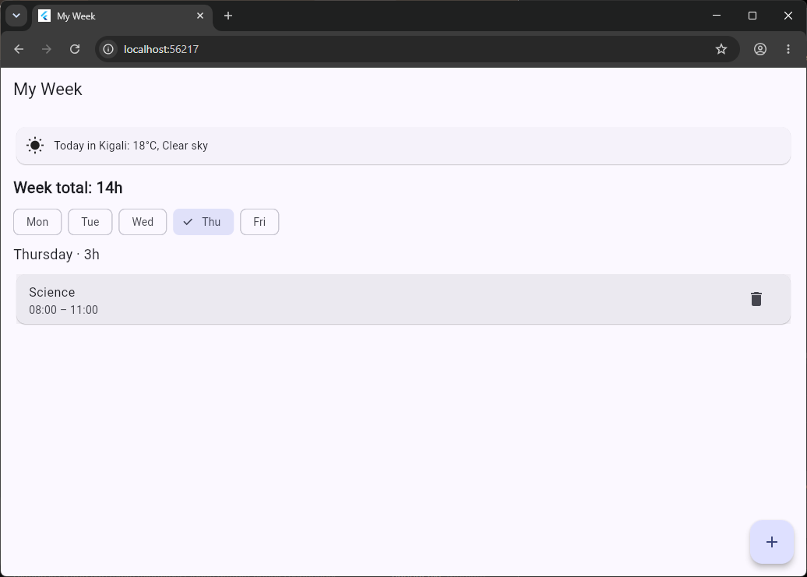
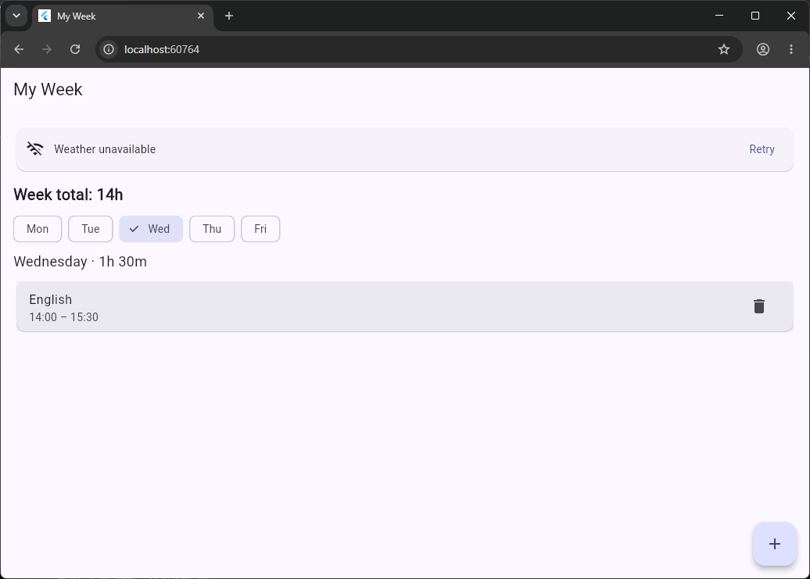

# My Week

A Flutter app that keeps my weekly timetable, adds up my class hours and warns me when two courses clash. My data is now saved on the phone with shared_preferences, so nothing is lost when the app closes, and it shows today's weather in Kigali from the Open-Meteo API.

## Screenshots

## Features
- Day chips (Mon to Fri) with that day's courses in order of start time
- Add and edit a course: name, day, start and end time typed as 08:00
- Times are checked: 8h, 25:00, 10:75 and an end time not after the start are refused
- Clashing courses are shown in red with "Clashes with ..."
- Total class time for each day and for the week (like 3h 30m)
- "No classes on Wednesday" when a day is empty
- Delete a course after an "Are you sure?" dialog
- Saves all courses on the phone with shared_preferences
- Live weather badge with three states: loading, error with Retry, and data

## Think questions

**1. Write your clash condition in plain words. Why < and not <=?**

Two courses on the same day clash if each one starts before the other one ends. In code: `a.start < b.end && b.start < a.end`. I use `<` and not `<=` because a course that ends at 11:00 and another that starts at 11:00 only touch, they do not overlap. With `<=` they would be shown as a clash, which is wrong.

**2. Why is it easier to store times as minutes than as text like 08:30?**

Minutes are numbers, so I can compare them directly (`<`), sort by them and subtract them to get a duration (end minus start). With text I would have to cut it apart every time, and sorting text can give a wrong order: "9:00" comes after "10:00" alphabetically. I only turn minutes back into text like 08:30 when I show them on the screen.