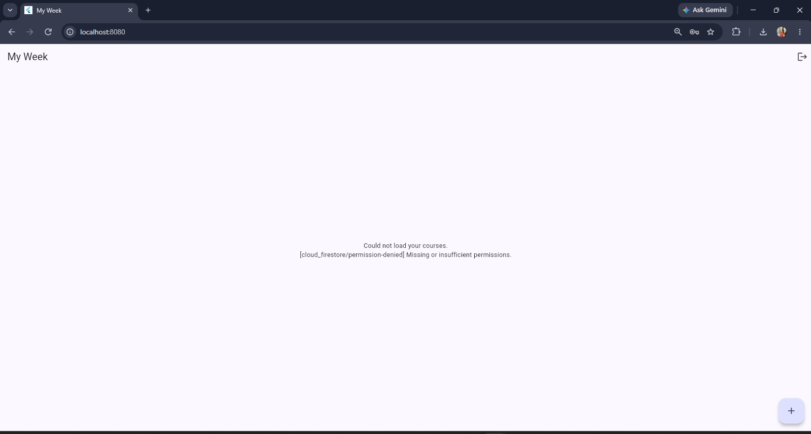
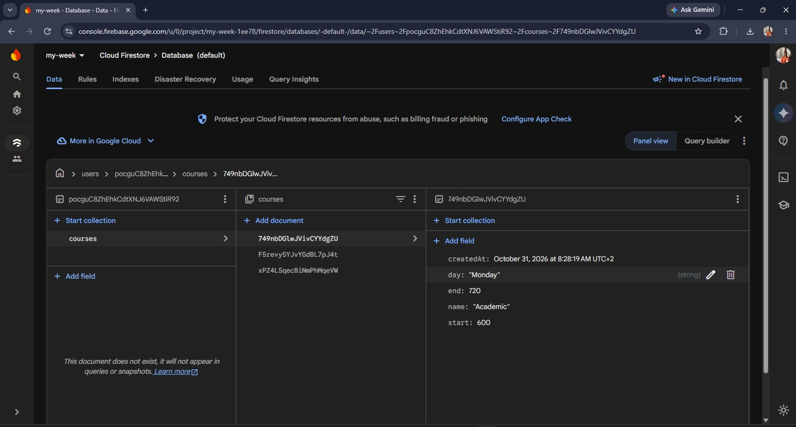

# My Week

A Flutter app that keeps my weekly timetable, adds up my class hours and warns me when two courses clash. Each user creates an account and logs in, and the courses are saved in the cloud with Firebase Cloud Firestore, so nothing is lost when the app closes and nobody can read another user's data. It also shows today's weather in Kigali from the Open-Meteo API.

## Screenshots

### With Firebase




### Before Firebase (courses saved on the phone)


## Features
- Create an account, log in and log out with email and password, with clear messages for wrong input
- Day chips (Mon to Fri) with that day's courses in order of start time
- Add and edit a course: name, day, start and end time typed as 08:00
- Times are checked: 8h, 25:00, 10:75 and an end time not after the start are refused
- Clashing courses are shown in red with "Clashes with ..."
- Total class time for each day and for the week (like 3h 30m)
- "No classes on Wednesday" when a day is empty
- Delete a course after an "Are you sure?" dialog
- All courses are saved in Cloud Firestore and shown live: a change made on another device or in the Firebase console appears in the app by itself
- Every user only sees their own courses
- Loading, error and empty states on the course list
- Live weather badge with three states: loading, error with Retry, and data

## How the data is stored

Each user's courses live under their own id:

```
users/{uid}/courses/{courseId}
    name   (string)
    day    (string, e.g. "Monday")
    start  (number, minutes since midnight, 08:00 = 480)
    end    (number, minutes since midnight)
    createdAt (timestamp)
```

The day totals, the week total and the clashes are computed from this list every time it arrives. They are never saved.

The Firestore security rules run on the server and only let a user read and write their own data:

```
rules_version = '2';
service cloud.firestore {
  match /databases/{database}/documents {
    match /users/{userId}/{document=**} {
      allow read, write: if request.auth != null && request.auth.uid == userId;
    }
  }
}
```

## How to run it

1. Install Flutter and Android Studio, then clone the project:
   ```
   git clone https://github.com/DOREN14/my_week
   cd my_week
   flutter pub get
   ```
2. Create your own Firebase project, turn on **Authentication > Email/Password**, create a **Firestore** database and publish the rules above.
3. For **Android**: register an Android app with the package name `com.example.my_week` and put your `google-services.json` in `android/app/`. Then run `flutter run` on an emulator or phone.
4. For **Chrome**: register a Web app in the same Firebase project and put its values in `webFirebaseOptions` in `lib/main.dart`. Then run `flutter run -d web-server --web-port 8080` and open `http://localhost:8080`.

## Project files

| File | What it does |
|------|--------------|
| `lib/main.dart` | Starts Firebase and opens the gate |
| `lib/auth_gate.dart` | Shows the login screen or the app, depending on who is logged in |
| `lib/login_screen.dart` | Create account and log in |
| `lib/week_screen.dart` | The live course list, add/edit screen, delete and logout |
| `lib/models.dart` | The Course class and the path to the user's courses |
| `lib/logic.dart` | Time checks, durations and clash calculation |
| `lib/weather.dart` | The Open-Meteo weather request |

## Think questions

**1. Write your clash condition in plain words. Why < and not <=?**

Two courses on the same day clash if each one starts before the other one ends. In code: `a.start < b.end && b.start < a.end`. I use `<` and not `<=` because a course that ends at 11:00 and another that starts at 11:00 only touch, they do not overlap. With `<=` they would be shown as a clash, which is wrong.

**2. Why is it easier to store times as minutes than as text like 08:30?**

Minutes are numbers, so I can compare them directly (`<`), sort by them and subtract them to get a duration (end minus start). With text I would have to cut it apart every time, and sorting text can give a wrong order: "9:00" comes after "10:00" alphabetically. I only turn minutes back into text like 08:30 when I show them on the screen.

**3. Why are the totals and clashes not saved in Firestore?**

They can always be worked out from the courses, so saving them as well would store the same fact twice. If I edited a course and forgot to update the saved total, the two would disagree. Computing them every time the list arrives keeps them always right.

**4. Why do the rules exist if the app already shows only the user's own courses?**

The app's code runs on the user's phone, so anyone could change it. The rules run on the server and check every read and write, so even a changed app cannot read another user's data. When I broke the rule on purpose, the app showed `[cloud_firestore/permission-denied]`.
